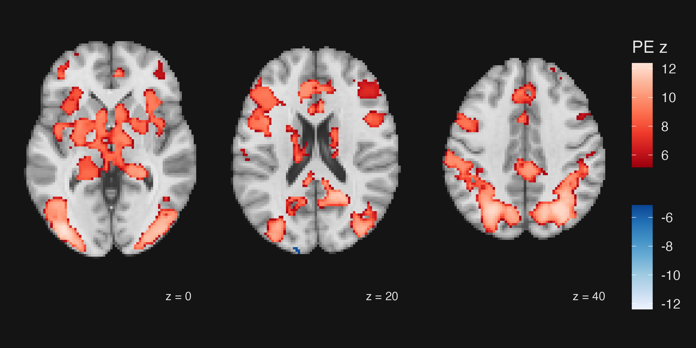

# ggbrain

ggbrain draws slices of NIfTI brain images with ggplot2. Layer statistical maps or atlas regions over an anatomical image, choose slice locations in millimeters or by voxel index, and save the rendered panels with `ggsave()`.

## Installation

```r
install.packages("ggbrain")
```

To install the development version from GitHub, use `remotes::install_github("michaelhallquist/ggbrain")`.

## Draw and save a slice montage

This example uses two aligned images included with the package. The name `underlay` selects the default grayscale anatomical layer. The second layer shows the signed prediction-error map in color.

```r
library(ggbrain)

anatomy <- system.file("extdata", "mni_template_2009c_2mm.nii.gz", package = "ggbrain")
activation <- system.file("extdata", "pe_ptfce_fwep_0.05_2mm.nii.gz", package = "ggbrain")

brain <- ggbrain(base_size = 11) +
  images(c(underlay = anatomy, activation = activation)) +
  slices(c("z = 0", "z = 20", "z = 40")) +
  geom_brain("underlay") +
  geom_brain("activation", name = "PE z") +
  annotate_coordinates()

figure <- render(brain)
plot(figure)
ggplot2::ggsave("brain-montage.png", plot = figure, width = 8, height = 4, dpi = 300)
```



Supply images on the same voxel grid. ggbrain checks their dimensions, voxel sizes, and voxel-to-world transforms. For a 4D NIfTI file, select a single 1-based volume with `images(c(activation = path), volumes = 3)`.

The package vignettes cover [slice selection and contrasts](https://michaelhallquist.github.io/ggbrain/articles/ggbrain_introduction.html), [atlas labels](https://michaelhallquist.github.io/ggbrain/articles/ggbrain_labels.html), and [plot aesthetics](https://michaelhallquist.github.io/ggbrain/articles/ggbrain_aesthetics.html). Open the installed guides with `browseVignettes("ggbrain")`.
